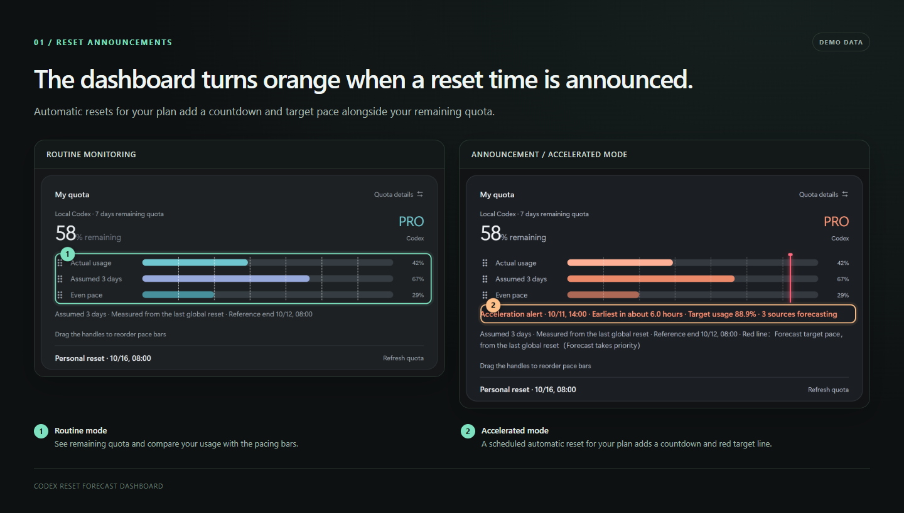
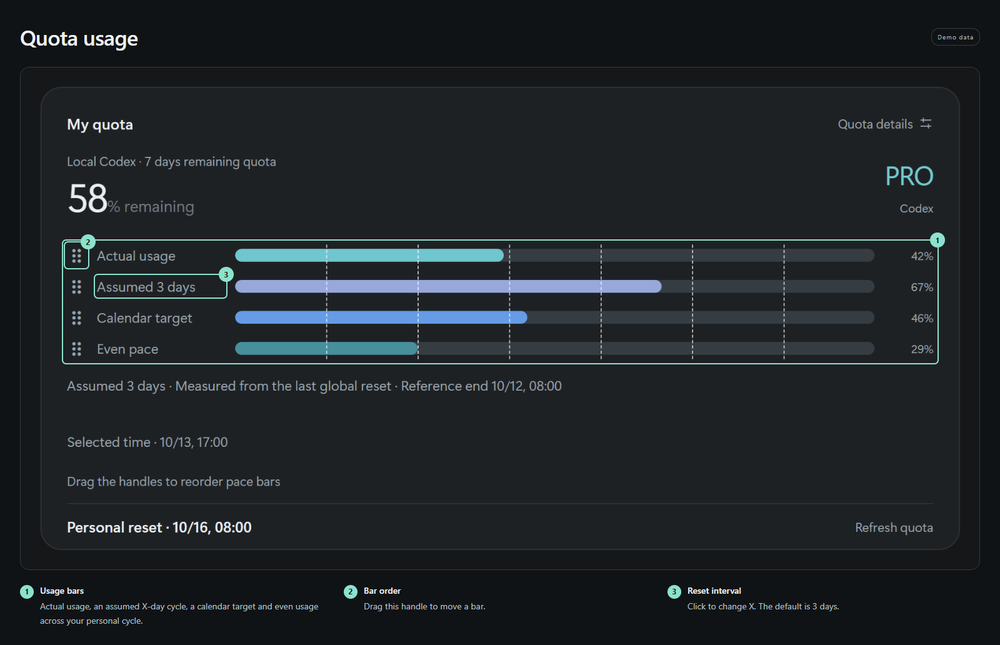
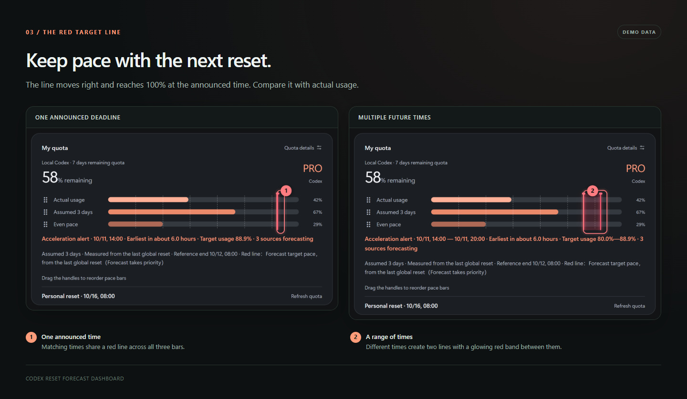
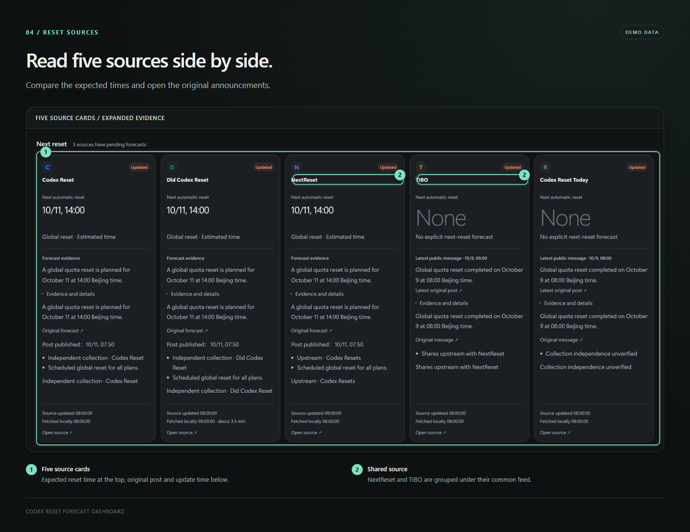
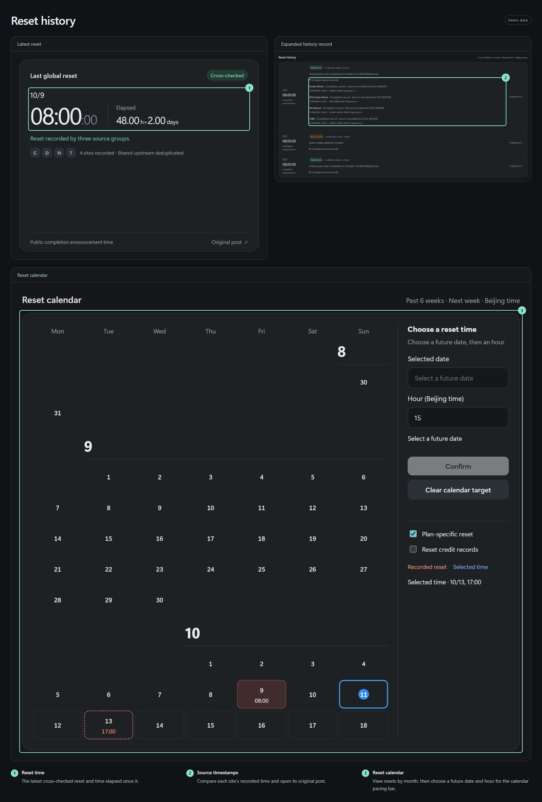
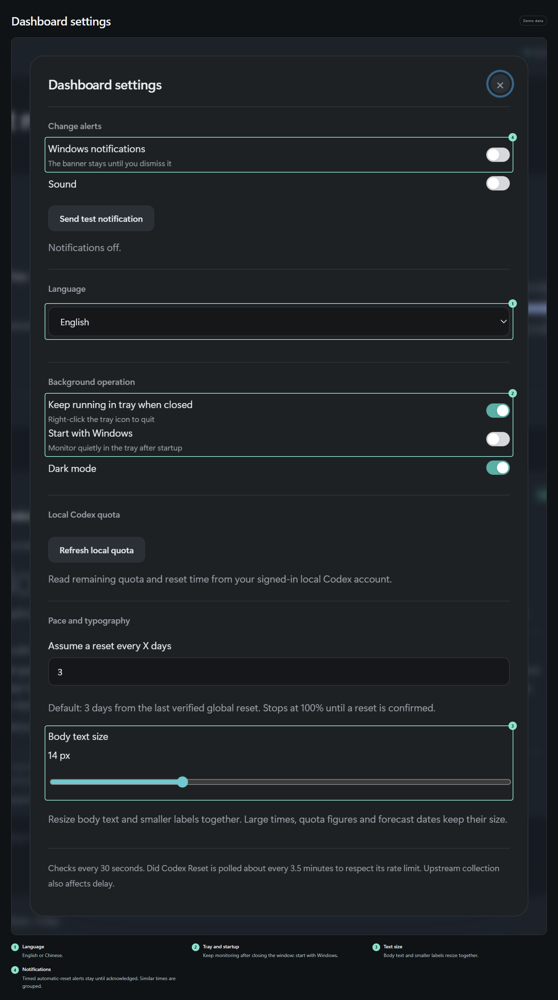

# Codex Reset Forecast Dashboard

[简体中文](README.zh-CN.md) · [Feature tour](https://zzy2670.github.io/codex-reset-forecast-dashboard/) · [Download for Windows](https://github.com/zzy2670/codex-reset-forecast-dashboard/releases/latest)

Follow Codex reset announcements from five websites alongside your remaining quota. When a reset time is announced, the dashboard turns orange and a red pacing line helps you plan your usage before then.

For Windows 10/11 x64. The app supports English and Chinese; the feature tour is available in seven languages.

## Install

1. Download the installer from [Releases](https://github.com/zzy2670/codex-reset-forecast-dashboard/releases/latest) and run it, or open the portable executable.
2. Open the dashboard to see public reset announcements. Choose your language, text size, tray behavior and startup settings.
3. To show personal quota, install the official [Codex CLI](https://github.com/openai/codex) and sign in with your ChatGPT account:

```powershell
npm install -g @openai/codex
codex login
```

Refresh quota or restart the dashboard after signing in.

<details>
<summary>Installation and runtime notes</summary>

- The dashboard detects an npm-installed CLI or codex.exe on PATH. If you use the Codex desktop app, also install the CLI using the steps above. Personal quota comes from the windows returned for your ChatGPT login.
- Release binaries are unsigned, so Windows may show an unknown-publisher prompt. SHA256SUMS.txt is included in each release to check your download.
- Both installed and portable versions save settings and cached data in your Windows profile. Upgrades keep that data.
- Startup with Windows is enabled by default and can be changed in Settings. Windows notification settings and Do Not Disturb affect notification display.

</details>

## A timed reset announcement turns the dashboard orange



The usual dark green view shows quota and usage pacing. An automatic-reset announcement with a time for your plan switches the view to orange and adds a countdown and red target line. See how much time and quota you have left together.

## Compare actual usage with two pacing guides



Three bars show actual consumption, an assumed X-day reset cycle and even usage across your personal cycle. X starts at 3 days and can be changed. Drag a bar by its handle to reorder it; the dashboard remembers your layout.

## Keep pace with the red line



The line moves right with time and reaches 100% at the announced reset time. It runs across all three bars, so you can compare it with actual usage. Matching times share one line. Different times create two lines with a glowing red band between them.

## Read five sources side by side



Each source has a card: expected time at the top, original post and update time below. Expand the details to compare posts. With no active forecast, the card shows “None”. Expired times leave the forecast display while their original posts remain in the details.

| Source | Fetch interval | Feed |
| --- | --- | --- |
| [Codex Reset](https://codex-reset.com/) | 30 seconds | Codex Reset |
| [Did Codex Reset](https://didcodexreset.com/) | About 3.5 minutes | Did Codex Reset |
| [NextReset](https://nextreset.ai/) | 30 seconds | Codex Resets |
| [TIBO](https://tibo.cc/) | 30 seconds | Same feed as NextReset |
| [Codex Reset Today](https://codex-reset.today/) | 30 seconds | Upstream pending confirmation |

Comparisons group records by their feed. NextReset and TIBO belong to the same group.

## Compare the times recorded by each site



The latest reset and elapsed time appear at the top. History starts on September 1, 2026, newest first. Expand a record to compare each site's timestamp down to the second, original post and shared feed. Times use Beijing time. Records identify global resets, plan-specific resets and reset credits.

## Adjust the text and keep monitoring in the tray



Choose English or Chinese; source posts keep their original wording. Body text and smaller labels resize together, while large times and numbers keep their size. Close to tray to keep monitoring, and enable startup with Windows.

Scheduled automatic resets for your plan use persistent notifications with an **Acknowledge** button. Messages with similar reset times are grouped, including matching announcements from different sites.

Personal quota is read through the official local Codex service; settings and cached data are stored on your computer. See [Privacy](PRIVACY.md) for data flows.

## Run from source

Use Windows x64 and Node.js 24:

```powershell
npm ci
npm test
npm run check
npm run test:ui
npm start
npm run build
```

Installer and portable builds go to dist/. GitHub Actions checks the code, builds the app and publishes checksums. GitHub Pages hosts the feature tour. Run npm run assets to regenerate the six annotated images using demo data; this needs a locally installed Chrome.

## License and feedback

**GPL-3.0-only.** When distributing a modified version, provide the corresponding source under GPL-3.0. See [LICENSE](LICENSE) and [third-party notices](NOTICE.md).

For bugs, include your app version, steps to reproduce and error messages in an [Issue](https://github.com/zzy2670/codex-reset-forecast-dashboard/issues).
