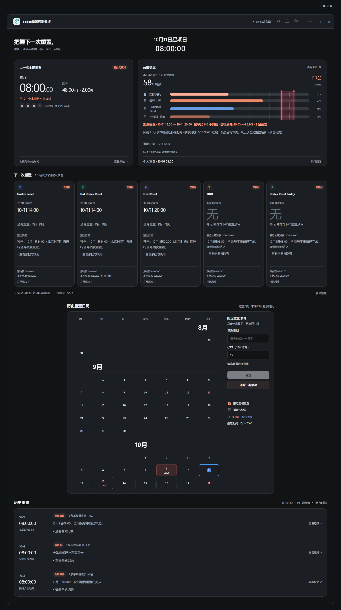
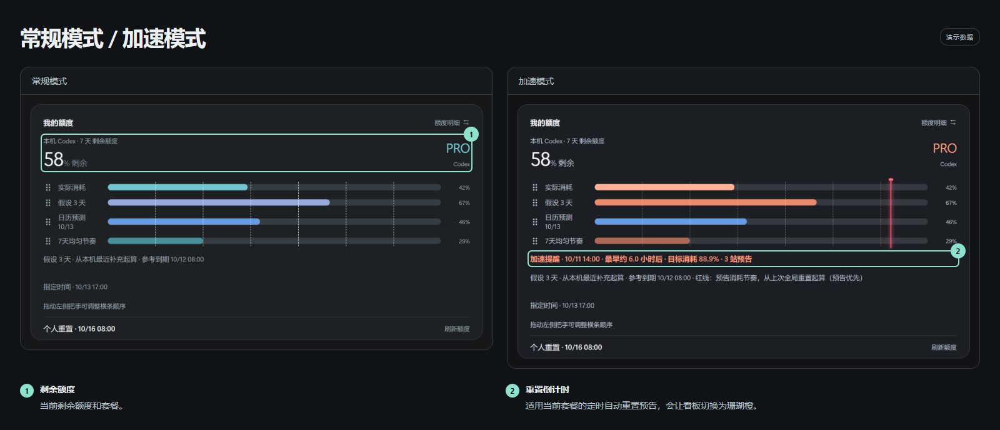
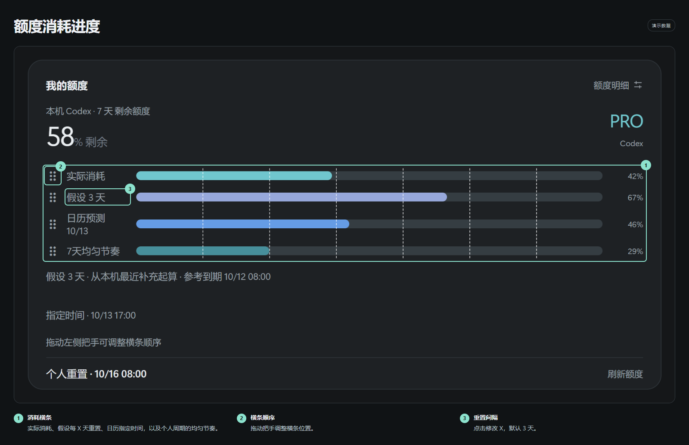
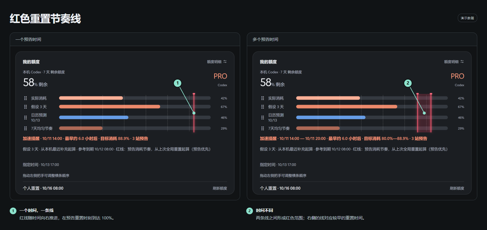
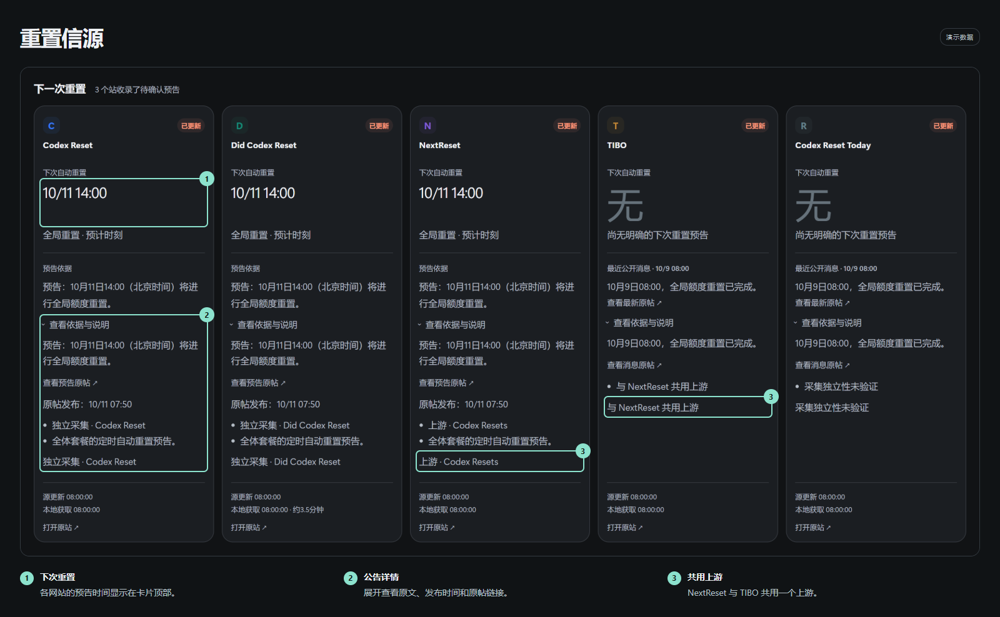
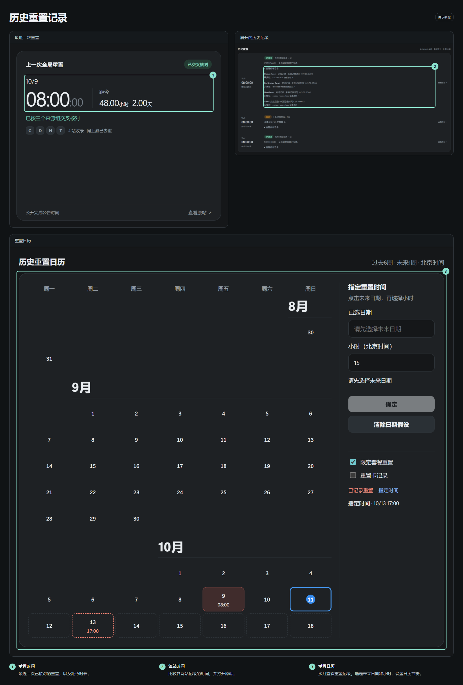
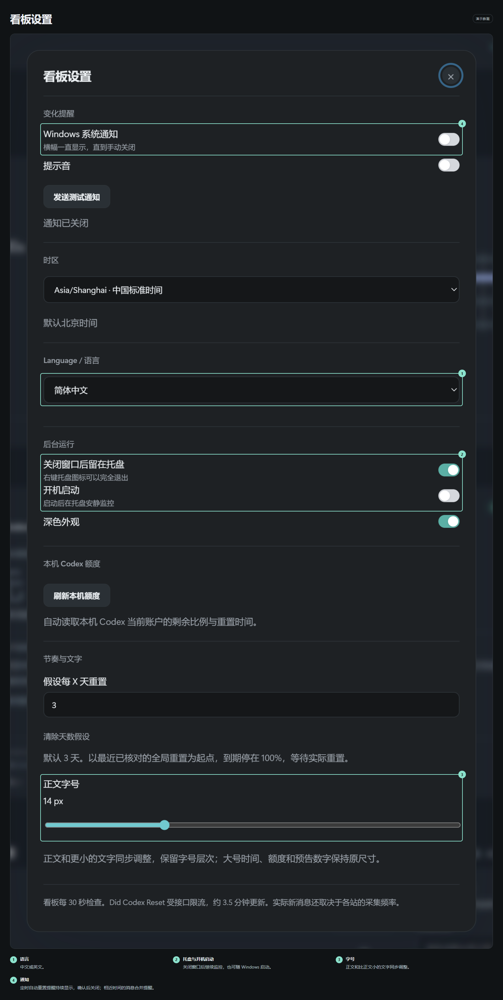

# codex重置预测看板

[English](README.md) · [图文介绍](https://zzy2670.github.io/codex-reset-forecast-dashboard/) · [下载 Windows 版](https://github.com/zzy2670/codex-reset-forecast-dashboard/releases/latest)

一款 Windows 桌面看板，用来查看 Codex 剩余额度、跟踪五个网站的重置预告，并比较历史重置时间。

适用于 Windows 10/11 x64。软件支持中英双语，介绍页可切换中、英、日、韩、西、法、德七种语言。



## 安装

1. 在 [Releases](https://github.com/zzy2670/codex-reset-forecast-dashboard/releases/latest) 下载安装版并双击安装，或直接运行便携版。
2. 打开看板即可查看公开重置消息。在设置中选择语言、字号、托盘和开机启动。
3. 看板内置官方 Codex 运行程序，会自动检测本机 Codex 的 ChatGPT 登录。已有本机授权直接读取额度，首次使用按提示登录即可。

### 让 AI 帮你部署

把这句话发给能操作电脑的 AI：

> 给我部署 https://github.com/zzy2670/codex-reset-forecast-dashboard ，并接入我的 Codex 额度。

AI 按仓库的 [部署说明](AGENTS.md) 运行 `scripts/install.ps1`，自动下载安装并检查额度连接。未登录时会打开官方授权页；完成授权后继续检查，实际读到额度才算部署完成。

<details>
<summary>安装与运行说明</summary>

- 安装包和便携版均内置官方 Codex 运行程序，无需另外安装 Node.js、npm 或 CLI。已有其他提供方配置时，看板会单独连接 ChatGPT 额度。
- 发行包未签名，Windows 可能显示未知发布者提示。发行页附有 SHA256SUMS.txt，可用于核对下载文件。
- 设置和缓存保存在 Windows 用户目录，安装版和便携版均使用此位置。升级会保留数据。
- 开机启动默认开启，可以在设置中关闭。Windows 的通知开关与勿扰模式会影响通知显示。

</details>

## 常规模式与加速模式



平时用绿色显示额度。当信源给出适用当前套餐的定时自动重置预告时，看板切换成珊瑚橙，并显示距离重置还有多久。

## 额度消耗进度



四条横条分别显示实际消耗、假设每 X 天重置的节奏、日历指定时间的节奏，以及个人周期的均匀节奏。X 默认 3 天，点击标签修改；日历预测独立设置，两个假设可分别清除。拖动左侧把手可以调整顺序。

“假设 X 天”从本机最近一次实际补充起算。自定义天数、日历指定时间和排序保持独立。

## 红色重置节奏线



红线随时间向右推进，在预告重置时刻到达 100%。拿它和实际消耗对照，可以安排重置前的使用。各站时间相同就合成一条线，时间不同则显示两条线和中间的红色范围。

## 五个重置信源



每列显示该网站的下次重置时间、公告和更新时间。展开详情可以阅读原文、打开原帖。NextReset 和 TIBO 共用一个上游，核对时归为同一组。

| 信源 | 获取间隔 | 来源 |
| --- | --- | --- |
| [Codex Reset](https://codex-reset.com/) | 30 秒 | Codex Reset |
| [Did Codex Reset](https://didcodexreset.com/) | 约 3.5 分钟 | Did Codex Reset |
| [NextReset](https://nextreset.ai/) | 30 秒 | Codex Resets |
| [TIBO](https://tibo.cc/) | 30 秒 | 与 NextReset 共用上游 |
| [Codex Reset Today](https://codex-reset.today/) | 30 秒 | 上游待确认 |

## 历史重置记录

日历按月份分开展示过去六周和未来一周；重置当天标红，今天用蓝框和蓝圈标出，日期和时间默认显示为北京时间，可在设置中切换时区。点击未来日期、输入小时并确认，即可设置独立的日历节奏横条。



从 2026 年 9 月开始收录，最新记录排在最上面。展开一条记录，可以逐站比较时间并查看原帖。最近一次已核对的重置时间和距今时长，也会显示在看板顶部。

重置后默认 6 小时内不再重置，自动清理这段时间内的旧预告；重置后新发布的明确预告优先。

## Windows 自动弹窗


检测到适用当前套餐、带具体时间的自动重置预告或完成消息时，Windows 自动弹窗。点“确认收到”关闭；相近时间的消息合并提醒。

本机额度重置后，点“确认收到”可将重置系统通知静默 6 小时；重启后继续计时。

## 显示与后台设置



可切换中英文、调节字号、开关通知、开机启动或关闭至托盘。

个人额度通过本机官方 Codex 服务读取，设置和缓存保存在本机，具体数据流见 [隐私说明](PRIVACY.md)。

## 从源码运行

使用 Windows x64 和 Node.js 24：

```powershell
npm ci
npm test
npm run check
npm run test:ui
npm start
npm run build
```

安装包和便携版输出到 dist/。GitHub Actions 负责检查、构建和发布校验和；GitHub Pages 提供图文介绍页。运行 npm run assets 可用演示数据重新生成中英文两套各八张功能图，需要本机安装 Chrome。

## 许可证与反馈

采用 **GPL-3.0-only**。分发修改版时，按 GPL-3.0 提供对应源码。见 [LICENSE](LICENSE) 和 [依赖声明](NOTICE.md)。

遇到问题可以在 [Issues](https://github.com/zzy2670/codex-reset-forecast-dashboard/issues) 留下版本、复现步骤和报错信息。
