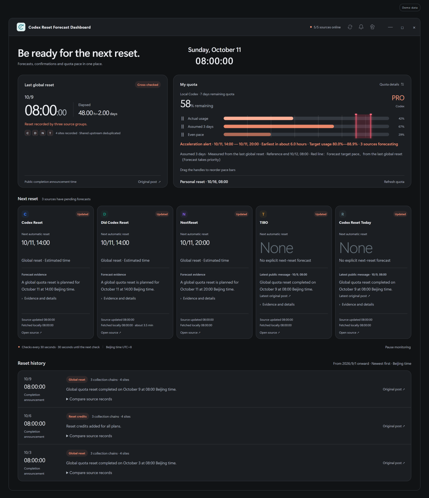
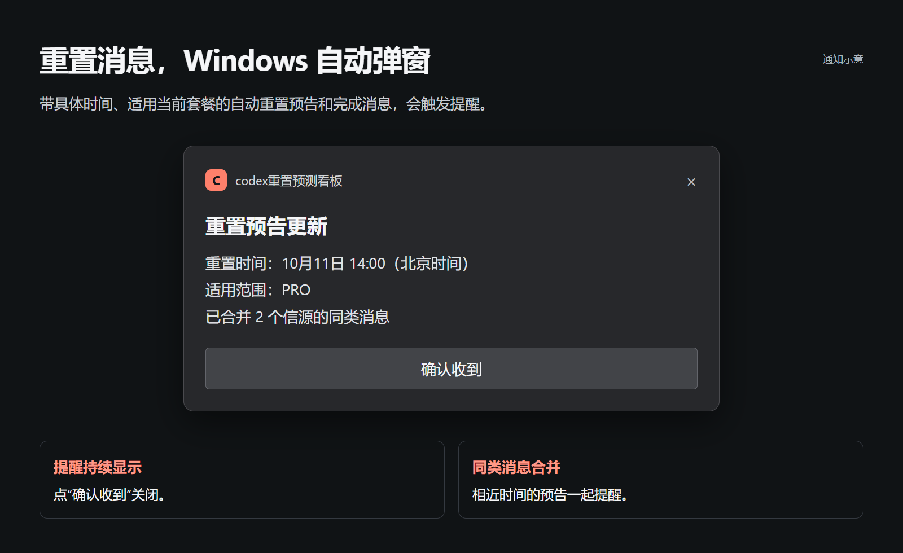

# codex重置预测看板

[English](README.md) · [图文介绍](https://zzy2670.github.io/codex-reset-forecast-dashboard/) · [下载 Windows 版](https://github.com/zzy2670/codex-reset-forecast-dashboard/releases/latest)

一款 Windows 桌面看板，用来查看 Codex 剩余额度、跟踪五个网站的重置预告，并比较历史重置时间。

适用于 Windows 10/11 x64。软件支持中英双语，介绍页可切换中、英、日、韩、西、法、德七种语言。



## 安装

1. 在 [Releases](https://github.com/zzy2670/codex-reset-forecast-dashboard/releases/latest) 下载安装版并双击安装，或直接运行便携版。
2. 打开看板即可查看公开重置消息。在设置中选择语言、字号、托盘和开机启动。
3. 要显示个人额度，安装官方 [Codex CLI](https://github.com/openai/codex)，并登录你的 ChatGPT 账户：

```powershell
npm install -g @openai/codex
codex login
```

登录后刷新额度，或重启看板。

<details>
<summary>安装与运行说明</summary>

- 看板识别 npm 安装的 CLI 或 PATH 中的 codex.exe。已安装 Codex 桌面版的用户也请按上面的步骤安装 CLI。个人额度来自 ChatGPT 登录后的额度窗口。
- 发行包未签名，Windows 可能显示未知发布者提示。发行页附有 SHA256SUMS.txt，可用于核对下载文件。
- 设置和缓存保存在 Windows 用户目录，安装版和便携版均使用此位置。升级会保留数据。
- 开机启动默认开启，可以在设置中关闭。Windows 的通知开关与勿扰模式会影响通知显示。

</details>

## 常规模式与加速模式


平时用绿色显示额度。当信源给出适用当前套餐的定时自动重置预告时，看板切换成珊瑚橙，并显示距离重置还有多久。

## 额度消耗进度


三条横条分别是实际消耗、个人周期的均匀节奏，以及假设每 X 天重置一次的节奏。X 默认 3 天，点击横条上的标签就能修改；拖动左侧把手可以调整顺序。

## 红色重置节奏线


红线随时间向右推进，在预告重置时刻到达 100%。拿它和实际消耗对照，可以安排重置前的使用。各站时间相同就合成一条线，时间不同则显示两条线和中间的红色范围。

## 五个重置信源


每列显示该网站的下次重置时间、公告和更新时间。展开详情可以阅读原文、打开原帖。NextReset 和 TIBO 共用一个上游，核对时归为同一组。

| 信源 | 获取间隔 | 来源 |
| --- | --- | --- |
| [Codex Reset](https://codex-reset.com/) | 30 秒 | Codex Reset |
| [Did Codex Reset](https://didcodexreset.com/) | 约 3.5 分钟 | Did Codex Reset |
| [NextReset](https://nextreset.ai/) | 30 秒 | Codex Resets |
| [TIBO](https://tibo.cc/) | 30 秒 | 与 NextReset 共用上游 |
| [Codex Reset Today](https://codex-reset.today/) | 30 秒 | 上游待确认 |

## 历史重置记录


从 2026 年 9 月开始收录，最新记录排在最上面。展开一条记录，可以逐站比较时间并查看原帖。最近一次已核对的重置时间和距今时长，也会显示在看板顶部。

## Windows 自动弹窗



检测到适用当前套餐、带具体时间的自动重置预告或完成消息时，Windows 自动弹窗。点“确认收到”关闭；相近时间的消息合并提醒。

## 显示与后台设置


可切换中英文、调节字号、开关通知、开机启动或关闭至托盘。

个人额度通过本机官方 Codex 服务读取，设置和缓存保存在本机，具体数据流见 [隐私说明](PRIVACY.md)。

## 从源码运行

使用 Windows x64 和 Node.js 24：

```powershell
npm ci
npm test
npm run check
npm run test:ui
npm start
npm run build
```

安装包和便携版输出到 dist/。GitHub Actions 负责检查、构建和发布校验和；GitHub Pages 提供图文介绍页。运行 npm run assets 可用演示数据重新生成八张功能图，需要本机安装 Chrome。

## 许可证与反馈

采用 **GPL-3.0-only**。分发修改版时，按 GPL-3.0 提供对应源码。见 [LICENSE](LICENSE) 和 [依赖声明](NOTICE.md)。

遇到问题可以在 [Issues](https://github.com/zzy2670/codex-reset-forecast-dashboard/issues) 留下版本、复现步骤和报错信息。
